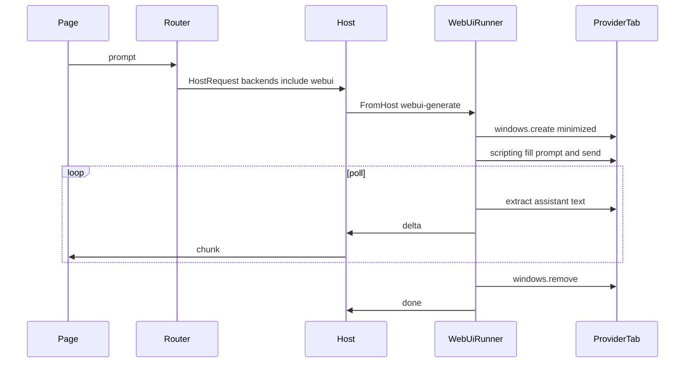

---
todos:
  - id: registry-perms
    status: in_progress
    content: 'Add webui provider registry, settings defaults, optional_host_permissions'
  - id: sw-runner
    content: Implement webui-llm.ts queue + shared DOM drivers for chatgpt/gemini/claude
    status: pending
  - id: host-rpc
    content: 'Extend host protocol, WebUiBackend, host makeBackend + router backendSpec/RPC'
    status: pending
  - id: ui-consent
    content: 'Options Web chat section, consent copy, playground/site backend listing'
    status: pending
  - id: tests-docs
    content: 'Unit fixtures, e2e stub round-trip, STATUS + docs plan copy'
    status: pending
name: Web UI LLM backends
overview: 'Add ChatGPT / Gemini / Claude web-chat backends that open a minimized tab in the user''s logged-in Chrome profile, submit the prompt, and scrape the reply—available to the playground and to approved sites as optional backends (same permission model as Google search).'
isProject: false
---
# Web-UI LLM backends (ChatGPT / Gemini / Claude)

## Decisions (locked)

- **Audience:** playground + approved sites (`LanguageModel` / `localLLM`) as new backend ids.
- **Auth:** reuse existing Chrome login cookies; user must already be signed in.
- **Shape:** new backend kind `webui`, not API adapters. Ids: `chatgpt-web`, `gemini-web`, `claude-web` (no collision with API providers `openai` / `gemini` / `anthropic`).
- **Where it runs:** service worker owns the window + `chrome.scripting` (same pattern as [`src/background/google-search.ts`](src/background/google-search.ts)). Offscreen host keeps session/tool/abort orchestration via a thin `WebUiBackend` that RPCs the worker.
- **v1 limits:** text-only, no tools, no images; one serialized generation at a time; non-true-streaming (poll DOM and yield text deltas until the UI shows “done”).

## Implementation

### 1. Provider registry + permissions

- Add [`src/shared/webui-providers.ts`](src/shared/webui-providers.ts): id, display name, origin pattern(s), start URL, synthetic model id (`default`).
- Extend [`src/manifest.json`](src/manifest.json) `optional_host_permissions` with:
  - `https://chatgpt.com/*`
  - `https://gemini.google.com/*`
  - `https://claude.ai/*`
- Wire into settings defaults in [`src/shared/settings.ts`](src/shared/settings.ts) like other providers (`enabled: false`, `keyRequired` N/A). New sites stay `allowedBackends: ["local"]` only.

### 2. SW runner (Google-search twin)

- Add [`src/background/webui-llm.ts`](src/background/webui-llm.ts):
  - Global serial queue
  - `webuiPermitted(id)`, `webuiGenerate({ providerId, prompt, signal, onDelta })`
  - `chrome.windows.create({ url, state: "minimized", focused: false })` → wait load → inject self-contained driver → poll → `windows.remove` in `finally`
  - Clear errors for login/consent/captcha walls (mirror Google’s “open once in Chrome…” style)
  - Keepalive: rely on existing host `keepalive` while the RPC is open; abort closes the window
- Pure DOM drivers in [`src/shared/webui-drivers/`](src/shared/webui-drivers/) (no closures) so unit tests can run them against HTML fixtures:
  - `chatgpt.ts`, `gemini.ts`, `claude.ts` — `fillAndSend(prompt)`, `readAssistant()`, `isDone()`, `isBlocked()`
- Flatten multi-turn host history to one prompt string in the backend (system + prior turns labeled); web UIs get a single paste.

### 3. Host ↔ SW protocol + `WebUiBackend`

- Extend [`src/shared/host-protocol.ts`](src/shared/host-protocol.ts):
  - `BackendSpec` += `{ kind: "webui"; providerId; model: string }`
  - `FromHost` += webui generate request; `ToHost` += delta/done/error replies (or a small dedicated pair on the existing host port)
- [`src/offscreen/webui-backend.ts`](src/offscreen/webui-backend.ts): implements `Backend` with `kind: "webui"`, `toolMode` unused/empty tools, `acceptsImages() === false`, `availability()` based on router only putting permitted+enabled specs in the chain
- [`src/offscreen/host.ts`](src/offscreen/host.ts) `makeBackend`: branch for `webui`
- [`src/background/router.ts`](src/background/router.ts): handle webui FromHost messages; `backendSpec()` builds webui specs when provider enabled + host permission granted (no API key)

### 4. Options / consent / playground

- Options: new “Web chat” section (enable checkbox requests optional host permission on click) — follow the Google/Tavily gesture pattern in [`src/ui/options.ts`](src/ui/options.ts)
- Sites list: include enabled webui ids in `enabledBackends` / labels
- Consent copy in [`src/ui/consent.ts`](src/ui/consent.ts): prompts are typed into the user’s logged-in ChatGPT/Gemini/Claude tab (not “billed to your API key”)
- Playground backend dropdown picks them up like other enabled providers

### 5. Trust / policy (match CLAUDE.md)

- Never accept provider URL, selectors, or prompt routing from the page message; router/SW pick fixed start URLs
- Optional hosts only (no new required permissions)
- Usage log: origin, time, backend id, rough token estimates from text length — never prompt text
- Rate-limit webui generations per origin (reuse/extend [`src/background/limits.ts`](src/background/limits.ts))

### 6. Tests + docs

- Unit: driver fixtures (blocked/login, mid-stream, done) in `test/webui-*.test.ts`
- E2E: stub `__test.setWebUiStub` (parallel to search stub) so CI never opens real provider tabs; one round-trip through polyfill with a site that allows `chatgpt-web`
- Update [`docs/STATUS.md`](docs/STATUS.md); on execution copy this plan into `docs/<timestamp>-…md` per CLAUDE.md

## Risks (reviewer notes)

- Provider DOMs change often; drivers will need maintenance; treat scrape failures as `NetworkError` / `NotAllowedError` with actionable messages
- Minimized window still uses the real profile session; captcha/login interstitials fail closed
- Third-party web UI automation may conflict with those sites’ terms; product/docs should describe it as optional, user-initiated use of the user’s own logged-in session
- Long generations: host keepalive + serial queue; hard timeout (e.g. 3–5 min) then abort and close the window
